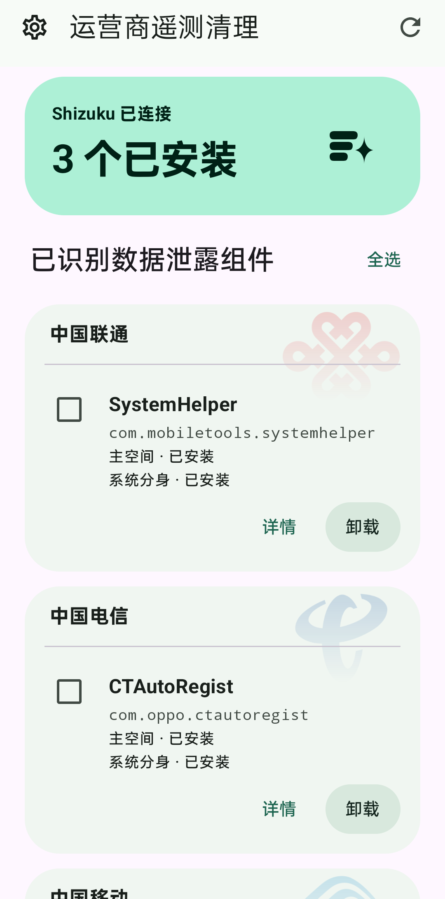
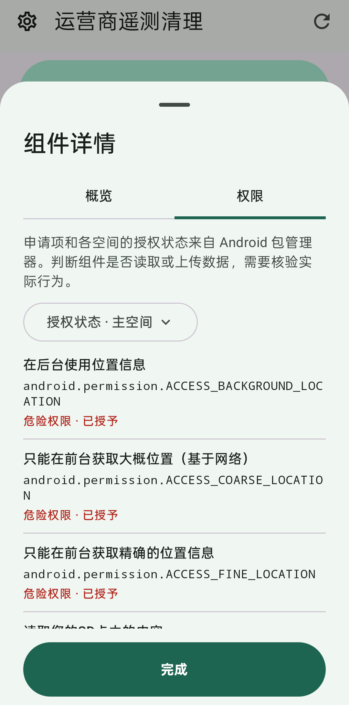
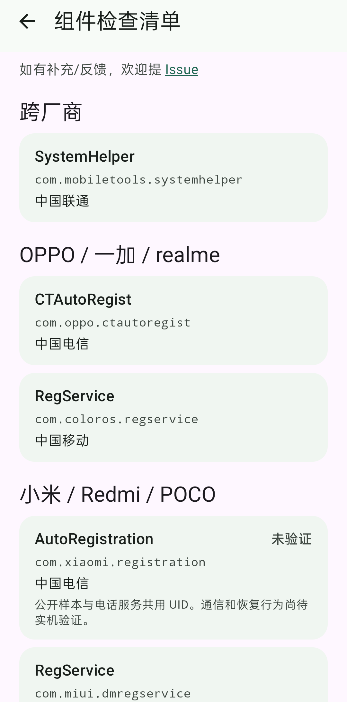

# 遥测清理 · TelemetryCleaner

> 运营商为终端入网、自注册、网络运维和故障排查，确有在相应场景收集必要数据的实际需求！本项目仅供学习，用于了解 Android 系统包管理机制。

TelemetryCleaner 可以检测国行 Android 固件预置的运营商组件，查看各空间的安装状态和权限，并管理卸载与恢复。下载： [GitHub Releases](https://github.com/Eynnzerr/TelemetryCleaner/releases/latest)

  
  
  

## 背景介绍

部分国产厂商在国行固件中预置了 `SystemHelper`、`RegService` 等运营商终端管理组件。这些组件在后台静默定时采集数据，用户无感；没有桌面入口，同时无法以常规手段禁用权限和卸载。

WiSec 2023 的流量测量还在部分国行样机上观察到运营商组件上报数据，其中小米及 ColorOS 样本的中国移动组件上报了已安装软件列表。 [WiSec 2023 实测论文](https://www.scss.tcd.ie/Doug.Leith/pubs/wisecfp034-liu.pdf#page=7)

在作者本人的 OPPO 真机上观测到 SystemHelper 有读取定位、设备和 SIM 标识、已安装应用以及按应用统计网络流量，随后向某云端上传的行为，分析详见 [SystemHelper 代码与权限分析 by AI](docs/systemhelper-analysis.md)。

## 本项目原理

Android 10 及以上设备可安装本项目，依赖 Shizuku。先按 [Shizuku 启动指南](https://shizuku.rikka.app/guide/setup/)通过 ADB 或无线调试启动 Shizuku，再回到 App 授权并选择需要检查的空间。Android 11 及以上可用无线调试启动。检测完成后，可打开组件详情查看权限，或勾选组件批量操作。

ADB 启动的 Shizuku 以 shell 身份代理 Binder 调用。App 直接请求系统包管理服务，避开部分 ROM 对 `pm` 命令行入口的拦截。系统包管理服务仍会执行本机的权限和包状态校验。 [Binder 调用实现](app/src/main/java/com/eynnzerr/telemetrycleaner/data/PackageBinder.kt)

卸载按选定空间执行，会清除该空间中的组件数据。恢复使用系统保留的 APK。自动清理默认关闭，开启后按配置的周期检查所选空间，只处理自动清理名单内的组件。

## 内置组件清单

表中的「未验证」指尚无本人在相应厂商设备上的卸载验证。

| 厂商 | 运营商 | 包名 | 卸载验证 |
| --- | --- | --- | --- |
| 跨厂商 | 联通 | `com.mobiletools.systemhelper` | 已实测 |
| OPPO / 一加 / realme | 电信 | `com.oppo.ctautoregist` | 已实测 |
| OPPO / 一加 / realme | 移动 | `com.coloros.regservice` | 已实测 |
| 小米 / Redmi / POCO | 电信 | `com.xiaomi.registration` | 未验证 |
| 小米 / Redmi / POCO | 移动 | `com.miui.dmregservice` | 未验证 |
| vivo | 移动 / 电信 | `com.vivo.devicereg` | 未验证 |
| 华为及旧荣耀 | 电信（数据） | `com.huawei.android.UEInfoCheck` | 未验证 |
| 华为及旧荣耀 | 电信（短信） | `com.huawei.android.AutoRegSms` | 未验证 |
| 华为 | 移动 | `com.huawei.regservice` | 未验证 |
| 荣耀 | 电信（数据） | `com.hihonor.android.UEInfoCheck` | 未验证 |
| 荣耀 | 电信（短信） | `com.hihonor.android.AutoRegSms` | 未验证 |
| 荣耀 | 移动（归属推断） | `com.hihonor.regservice` | 未验证 |
| 魅族 / Flyme | 归属待核验 | `com.meizu.regservice` | 未验证 |

本人只验证了 SystemHelper 和 OPPO 组件的卸载。其他厂商因缺少设备暂未验证，如决定卸载，请自行承担风险。

欢迎在 [Issues](https://github.com/Eynnzerr/TelemetryCleaner/issues) 反馈某厂商某模块卸载后使用正常，也欢迎补充组件。附上机型、系统版本、包名和实际结果，便于复核。
