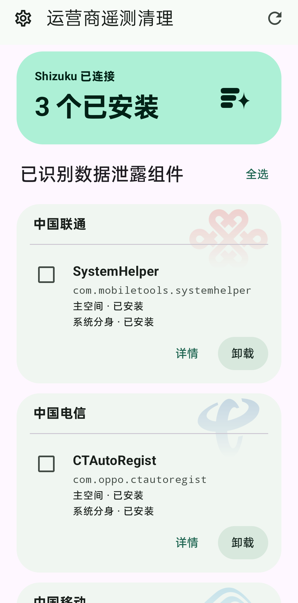
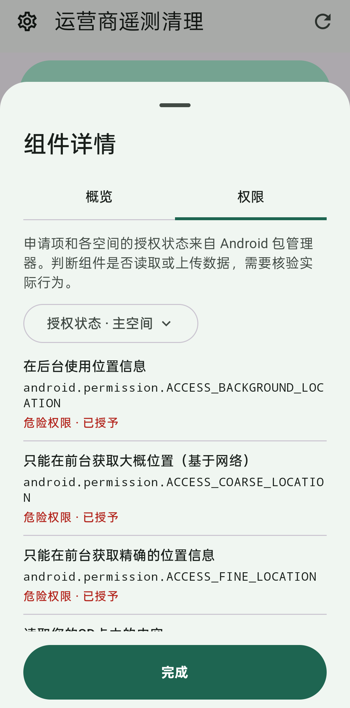
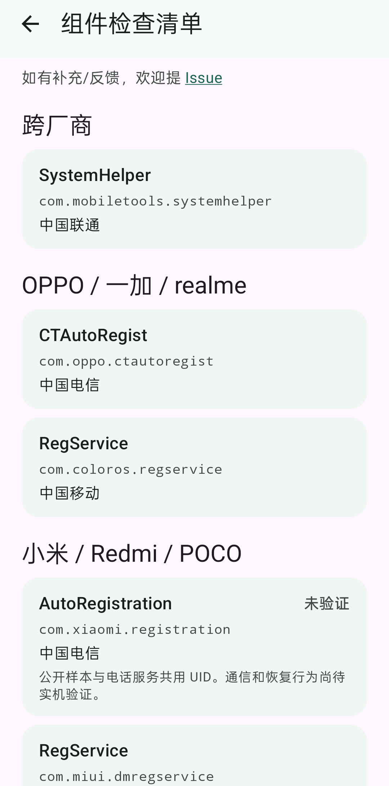

# 遥测清理 · TelemetryCleaner

> 运营商为终端入网、自注册、网络运维和故障排查，确有在相应场景收集必要数据的实际需求！本项目仅供学习，用于了解 Android 系统包管理机制。

TelemetryCleaner 可以检测国行 Android 固件预置的运营商组件，查看各空间的安装状态和权限，并管理卸载与恢复。下载： [GitHub Releases](https://github.com/Eynnzerr/TelemetryCleaner/releases/latest)

  
  
  

您可通过不限于以下方式参与贡献，欢迎 PR：
1. 提供清单未覆盖的厂商+运营商+包名线索，在 README.md 中补充即可；
2. 提供针对某模块的实测与分析报告，不限制是否为 AI 生成，但需保证真实性。放于 docs 目录中即可；
3. ~协助实现未支持的免 Root 卸载功能（如**现版本不支持部分 vivo 系的电信/移动组件卸载**）~；
4. 在 [Discussions](https://github.com/Eynnzerr/TelemetryCleaner/discussions) 或 [Issues](https://github.com/Eynnzerr/TelemetryCleaner/issues) 提供功能反馈、实测体验与改进建议。

## 背景介绍

部分国产厂商在国行固件中预置了 `SystemHelper`、`RegService` 等运营商终端管理组件。这些组件在后台静默定时采集数据，用户无感；没有桌面入口，同时无法以常规手段禁用权限和卸载。

WiSec 2023 的流量测量还在部分国行样机上观察到运营商组件上报数据，其中小米及 ColorOS 样本的中国移动组件上报了已安装软件列表。 [WiSec 2023 实测论文](https://www.scss.tcd.ie/Doug.Leith/pubs/wisecfp034-liu.pdf#page=7)

在作者本人的 OPPO 真机上观测到 SystemHelper 有读取定位、设备和 SIM 标识、已安装应用以及按应用统计网络流量，随后向某云端上传的行为，分析详见 [SystemHelper 代码与权限分析 by AI](docs/reports/oppo-telemetry-components.md)。

## 本项目原理

Android 10 及以上设备可安装本项目。默认使用 Shizuku，已获取 Root 的设备可在首页选择「使用 Root」，也可在设置里切换权限来源。扫描后可选择空间、查看组件权限或批量操作。

- **Shizuku**（[仓库](https://github.com/RikkaApps/Shizuku) · [下载最新 Release](https://github.com/RikkaApps/Shizuku/releases/latest)）· 按 [Shizuku 启动指南](https://shizuku.rikka.app/guide/setup/)通过 ADB 或无线调试启动服务，再回到 App 授权。Android 11 及以上支持无线调试启动。
- **Dhizuku 增强（可选，配合 Shizuku 使用）**（[仓库](https://github.com/iamr0s/Dhizuku) · [下载最新 Release](https://github.com/iamr0s/Dhizuku/releases/latest)）· 若已安装并激活 Dhizuku（设备所有者 / Device Owner），可在设置页的「权限来源」中开启「Dhizuku 增强」。当 Shizuku（UID 2000）被 ROM 拦截时，主空间（用户 0）将自动回落到 Dhizuku 代理的 `PackageInstaller` / `DevicePolicyManager` 接口继续尝试。 [Dhizuku 桥接实现](app/src/main/java/com/eynnzerr/telemetrycleaner/data/packagemanager/DhizukuBridge.kt)
- **Root** · 在 Root 管理器里授权 Telemetry Cleaner，回到首页连接 Root。扫描、卸载、恢复和自动清理通过 Root 会话执行，无需安装 Shizuku。

ADB 启动的 Shizuku 以 shell 身份代理 Binder 调用。App 直接请求系统包管理服务，避开部分 ROM 对 `pm` 命令行入口的拦截。系统包管理服务仍会执行本机的权限和包状态校验。 [Binder 调用实现](app/src/main/java/com/eynnzerr/telemetrycleaner/data/packagemanager/PackageBinder.kt)

少数 ROM 会在命令层拒绝卸载系统应用，例如返回 `Failure [only root can delete system app for a particular user]`。Shizuku 模式可通过 `app_process` 调用 `IPackageManager.deletePackageAsUser` 再试一次；若开启了「Dhizuku 增强」，在 shell 身份仍被拦截时还会进一步通过 Device Owner 通道尝试（进入 PMS 时身份切换为 `UID 1000` 并携带 `DELETE_SYSTEM_APP`，已在未 Root ColorOS 16 真机实测通过 `com.oplus.olc` 卸载与恢复，详见 [OLC 保护分析](docs/reports/oplus-olc-protection.md)）。App 回读包状态确认结果，失败时结果页保留原始系统错误。 [app_process 兜底实现](app/src/main/java/com/eynnzerr/telemetrycleaner/data/packagemanager/PackageFallback.kt)

卸载按选定空间执行，会清除该空间中的组件数据。恢复使用系统保留的 APK。自动清理默认关闭，开启后按配置的周期检查所选空间，只处理自动清理名单内的组件。使用 Root 时，设备重启或 App 进程退出后，需在首页重新连接 Root 才会继续自动清理。

**已知限制：vivo OriginOS 的 `com.vivo.devicereg`、ColorOS 的 `com.oplus.olc` 等受系统保护组件在纯 Shizuku（UID 2000）下会被拦截，需开启可选的「Dhizuku 增强」（仅主空间用户 0）或使用 Root；其中 `com.vivo.devicereg` 的 Dhizuku 路径仍欢迎社区实测反馈。**

## 内置组件清单

表中的「未验证」指尚无本人在相应厂商设备上的卸载验证。

| 厂商 | 运营商 | 包名 | 卸载验证 |
| --- | --- | --- | --- |
| 跨厂商 | 联通 | `com.mobiletools.systemhelper` | 已实测 |
| OPPO / 一加 / realme | 电信 | `com.oppo.ctautoregist` | 已实测 |
| OPPO / 一加 / realme | 移动 | `com.coloros.regservice` | 已实测 |
| 小米 / Redmi / POCO | 电信 | `com.xiaomi.registration` | 已实测 |
| 小米 / Redmi / POCO | 移动 | `com.miui.dmregservice` | 已实测 |
| vivo | 移动 / 电信 | `com.vivo.devicereg` | 需 Root / Dhizuku（待验证） |
| 华为及旧荣耀 | 电信（数据） | `com.huawei.android.UEInfoCheck` | 已实测 |
| 华为及旧荣耀 | 电信（短信） | `com.huawei.android.AutoRegSms` | 已实测 |
| 华为 | 移动 | `com.huawei.regservice` | 已实测 |
| 荣耀 | 电信（数据） | `com.hihonor.android.UEInfoCheck` | 已实测 |
| 荣耀 | 电信（短信） | `com.hihonor.android.AutoRegSms` | 已实测 |
| 荣耀 | 移动 | `com.hihonor.regservice` | 已实测 |
| 魅族 / Flyme | 移动 | `com.meizu.regservice` | 已实测 |
| 初代红魔 | 电信 | `cn.nubia.register` | 未验证 |

本人只验证了 SystemHelper 和 OPPO 组件的卸载，小米、华为由网友验证实测。其他厂商因缺少设备暂未验证，如决定卸载，请自行承担风险。

各厂商社区实测机型与已知问题整理见 [机型实测与使用反馈](docs/user-feedback.md)。欢迎在 [Discussions](https://github.com/Eynnzerr/TelemetryCleaner/discussions) 分享机型实测结果、使用提问或功能讨论；如遇到 Bug 或有未收录的新组件包名线索，请在 [Issues](https://github.com/Eynnzerr/TelemetryCleaner/issues) 提交。反馈时请尽量附上机型、系统版本、包名和实际结果，便于复核。

### 待验证组件线索

下列包名暂未加入 App 的检测、卸载或自动清理清单。

| 厂商 | 疑似用途 | 包名 | 社区反馈 |
| --- | --- | --- | --- |
| 摩托罗拉 / Moto 国行 | 中国移动 / 中国电信终端自注册（待核实） | `com.motorola.regservice` | [#59](https://github.com/Eynnzerr/TelemetryCleaner/issues/59)：Moto g100s 报告可用 ADB 禁用；未提供固件版本，未验证卸载及对通话、短信、移动数据的影响 |

[公开的 Moto X30 进程记录](https://newandroidbook.com/ddb/X30/)也出现了该包名。#59 所列域名与[中国移动](https://www.scss.tcd.ie/Doug.Leith/pubs/wisecfp034-liu.pdf#page=7)和[中国电信](https://nrfconnectdocs.nordicsemi.com/ncs/latest/nrf/libraries/modem/zzhc.html)的终端自注册服务吻合，但尚未在 Moto 样机上核实实际联网行为。

## WIP

- [ ] 努比亚、国行三星、魅族运营商遥测组件包名收集
- [ ] 扩充更多组件检测（包括厂商自己的敏感数据收集组件）作为可选项
- [x] 为受 ROM 保护的组件增加可选的 Dhizuku（设备所有者）免 Root 增强通道

## 致谢

本项目的免 Root 能力依托以下优秀开源项目，感谢作者与维护者的贡献；未安装的用户可直接前往对应 Releases 页面下载：

- **[Shizuku](https://github.com/RikkaApps/Shizuku)**（[下载 Releases](https://github.com/RikkaApps/Shizuku/releases/latest) · [Shizuku-API](https://github.com/RikkaApps/Shizuku-API) · [启动指南](https://shizuku.rikka.app/guide/setup/)）—— 提供免 Root 的 ADB / 无线调试 Binder 代理能力。
- **[Dhizuku](https://github.com/iamr0s/Dhizuku)**（[下载 Releases](https://github.com/iamr0s/Dhizuku/releases/latest) · [Dhizuku-API](https://github.com/iamr0s/Dhizuku-API)）—— 提供 Device Owner 权限共享能力，用于增强处理受 ROM 保护的主空间组件。

<a href="https://www.star-history.com/?repos=Eynnzerr%2FTelemetryCleaner&amp;type=date">
  <picture>
    <source media="(prefers-color-scheme: dark)" srcset="https://api.star-history.com/chart?repos=eynnzerr%2Ftelemetrycleaner&amp;type=date&amp;theme=dark">
    
  </picture>
</a>
